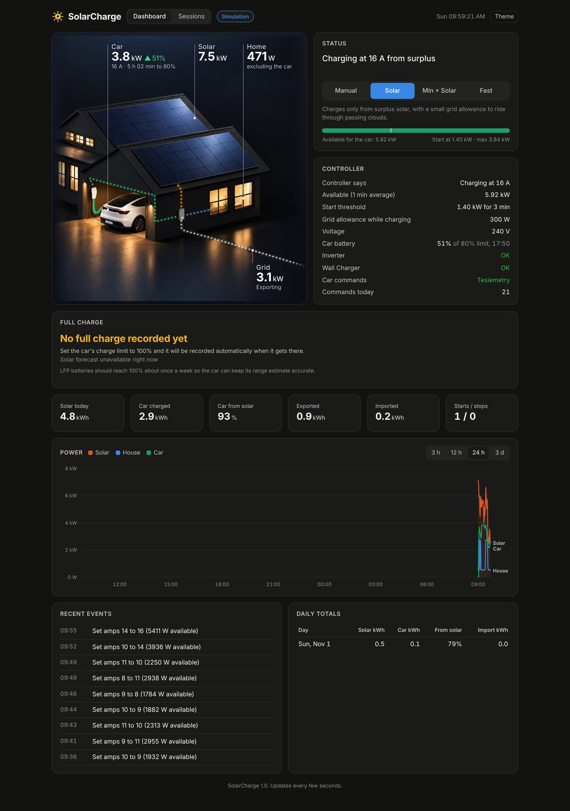
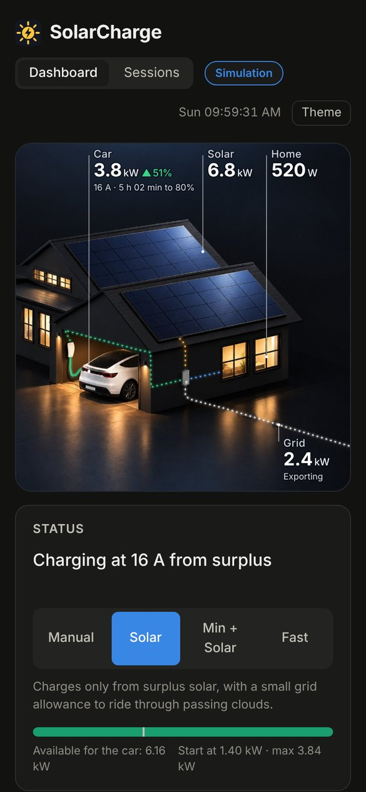

# SolarCharge

Charge a Tesla from surplus solar, controlled locally from a Raspberry Pi.

SolarCharge reads a Sungrow inverter and smart meter every 10 seconds, then starts, stops and adjusts the car's charging amps so it only uses solar you would otherwise export. Commands go straight to the car over Bluetooth using Tesla's own open source [vehicle command](https://github.com/teslamotors/vehicle-command) tool, so there is no cloud and no subscription. [Teslemetry](https://teslemetry.com) can be added as an optional backup.



## Features

* **Solar surplus charging** that follows the sun: starts when there is enough spare solar, raises and lowers the amps as clouds come and go, and stops when the surplus runs out
* **Local Bluetooth control** of the car, free and without the internet, with automatic fallback to Tesla's own API or Teslemetry if Bluetooth is busy or fails
* **Four modes:** Manual, Solar, Min + Solar (always at least the minimum amps) and Fast
* **Dashboard** in the style of the Tesla app, with live power flows, battery level and time to your charge limit. Works on a phone too. A **Status** tab shows the controller's working and recent events, and a **Meter** tab the power graph (up to 30 days), a daily energy chart, today's totals, daily totals and a running estimate of your electricity bill for the current billing period
* **Permanent archive** of daily totals and minute by minute data as CSV files you can download and open in Excel
* **Sessions page** for every charge, from plugging in to unplugging: energy, solar share, energy that reached the battery, cost and money saved, with a CSV download. With TeslaTrack, charging away from home is listed too, with Superchargers marked in red. Today's charging and the daily totals are here as well
* **Weather card** with the current conditions, today's high and low, and the next 12 hours: temperature, chance of rain and expected solar output
* **Full charge tracker** for LFP batteries, which should reach 100% about once a week. It shows when the last one happened and suggests the sunniest day for the next, using a free solar forecast from Open Meteo
* **Easy on the SD card:** routine readings live in RAM, only events and summaries are saved to disk
* **Python standard library only**, nothing to install. Runs happily alongside Pihole on an old Pi

For trips, battery health, tyres, temperatures and the car's status, see the companion app **[TeslaTrack](https://github.com/brad-24/teslatrack)**. They run side by side on the same Pi.



## What you need

| | |
|---|---|
| Inverter | A Sungrow residential inverter with a Sungrow smart meter and the WiNet S dongle, reachable on your network with Modbus TCP (port 502). Tested on an SG10RS, single phase, no battery |
| Charger | Tesla Wall Connector Gen 3 on your network. Optional, but it is how SolarCharge knows when the car is plugged in |
| Car | A Tesla that supports Tesla's vehicle command protocol (current models). Tested on a Model Y |
| Computer | A Raspberry Pi with Bluetooth, within Bluetooth range of the car. Tested on a Pi 3 Model B running Raspbian Buster. Any Linux machine with Python 3.7 or later and Bluetooth should work |
| Optional | A Teslemetry account, as a backup for car commands and for live battery level streaming |

## Install

On the Pi:

```
cd ~
git clone https://github.com/brad-24/solarcharge.git
cd solarcharge
cp config.example.ini config.ini
```

Then download `tesla_control_armv7.tar.gz` from the [Releases](https://github.com/brad-24/solarcharge/releases) page and unpack it into the `bin` folder:

```
mkdir -p ~/solarcharge/bin
tar xzf tesla_control_armv7.tar.gz -C ~/solarcharge/bin
chmod +x ~/solarcharge/bin/tesla-*
sudo setcap 'cap_net_admin=eip' ~/solarcharge/bin/tesla-control
```

These are Tesla's vehicle command tools built for the Pi. You can also build them yourself from [Tesla's repository](https://github.com/teslamotors/vehicle-command).

## Try it with fake data first

```
python3 ~/solarcharge/solarcharge.py --simulate --speed 30
```

Open `http://<pi address>:8080` in a browser. A fake house, sun and car run 30 times faster than real time, so you can watch it start, ramp up and down through clouds, and stop. Nothing real is touched. Press Ctrl+C to finish.

## Configure

```
nano ~/solarcharge/config.ini
```

At minimum, set:

1. `[inverter] host`: your inverter's IP address
2. `[charger] host`: your Wall Connector's IP address
3. `[tesla] vin`: your car's VIN
4. `[control] max_amps`: your Wall Connector's commissioned limit, or lower
5. `[schedule]` latitude, longitude and solar system size, then `forecast = true`
6. `[tariff]` your import price and feed in credit, for the Sessions page

Every setting is explained in the file.

Then check that each device can be read:

```
python3 ~/solarcharge/solarcharge.py --check
```

Compare the solar, house and grid figures with the iSolarCloud app. The register numbers in the config suit Sungrow string inverters, but check them on yours.

## Pair the car over Bluetooth

A one time step, done sitting in the car with your key card. See [PAIRING.md](PAIRING.md).

## Optional: Teslemetry backup

If you want a cloud backup for when Bluetooth is busy (phones and watches can fill the car's Bluetooth slots), create an access token in the Teslemetry console and save it where only you can read it:

```
nano ~/.solarcharge_token
chmod 600 ~/.solarcharge_token
```

Teslemetry also needs its virtual key added to the car. Follow the prompts in their console. Each command costs Teslemetry credits, so Bluetooth stays the main route.

For live battery level, charge limit and time to full, turn on BatteryLevel, ChargeLimitSoc and TimeToFullCharge in the Teslemetry console under Telemetry Configuration. The stream never wakes the car or uses command credits. For energy that reached the battery on the Sessions page, also turn on ACChargingEnergyIn.

If TeslaTrack runs on the same Pi, set `teslatrack_url = http://localhost:8084` under `[tesla]` in config.ini and SolarCharge takes these values from TeslaTrack instead, so only one app holds the stream. TeslaTrack also tells SolarCharge which days the car is usually home, for the Full charge card.

## Optional: Tesla API backup

Tesla's own Fleet API can be a free backup between Bluetooth and Teslemetry, so commands rarely cost credits even when phone keys fill the car's Bluetooth slots. See [FLEET.md](FLEET.md).

## Run it as a service

The service file assumes the user `pi` and the folder `/home/pi/solarcharge`. Edit it first if yours differ.

```
sudo cp ~/solarcharge/solarcharge.service /etc/systemd/system/
sudo systemctl daemon-reload
sudo systemctl enable --now solarcharge
```

It now starts on boot and restarts itself if it stops. Useful commands:

```
sudo systemctl status solarcharge          is it running
sudo systemctl restart solarcharge         after editing config.ini
journalctl -u solarcharge -f               live events
tail -f ~/solarcharge/data/events.log      saved events
```

## Going live

SolarCharge starts in **dry run**: it works out and logs every decision but sends nothing to the car. Watch it for a day or two, and when you are happy:

1. Turn off any other app that controls charging. Two controllers fighting over one car will cause chaos
2. Set `dry_run = false` in config.ini
3. `sudo systemctl restart solarcharge`

## Modes

| Mode | What it does |
|---|---|
| Manual | Watches and logs only. Use the Tesla app as normal |
| Solar | Surplus solar only, with a small grid allowance to ride through passing clouds |
| Min + Solar | Always at least the minimum amps while plugged in, plus any surplus |
| Fast | Full amps now, regardless of solar |

Things to know in Solar mode:

* If you plug in at night, the car starts charging by itself and SolarCharge stops it after a few minutes. Switch to Fast or Manual if you want it to keep going
* When the car reaches its charge limit it stops drawing power. SolarCharge notices and backs off for 30 minutes. If it knows the battery level (from Teslemetry or TeslaTrack), it doesn't try again until the level drops below the limit
* If the inverter can't be read for a minute, charging stops

## How the decisions are made

Every 10 seconds:

* **Available power** = export to the grid + what the car is drawing now, averaged over the last minute or so
* **Start** when available power covers the minimum amps plus a margin for 3 minutes
* **While charging**, amps follow the available power plus a small grid allowance. Amps rise gradually when there is clear headroom and fall quickly when the house starts importing, with an emergency cut if it imports heavily
* **Stop** when even the minimum amps can't be covered

Over Bluetooth, amp changes are free, so it follows the sun more closely than over Teslemetry. Every number is a setting in config.ini.

## Remote access

The dashboard has **no login** and can start and stop charging. **Never** open port 8080 on your router or expose it to the internet. For access away from home, use a private network such as [Tailscale](https://tailscale.com) (run `tailscale up --accept-dns=false` if the Pi also runs Pihole).

## Files

| Where | What |
|---|---|
| `solarcharge.py` | the program |
| `dashboard.html`, `sessions.html` | the web pages |
| `config.ini` | your settings (not in the repository; copy from `config.example.ini`) |
| `data/` | events log, saved history and sessions (SD card, a few small writes a day) |
| `data/archive/` | permanent archive: daily totals and minute by minute data, one CSV per month, written just after midnight (about 20 MB a year). Download from the dashboard under Daily totals |
| `/dev/shm/solarcharge/` | every reading (RAM only, cleared on reboot) |

Keep `config.ini`, `data/`, `~/.solarcharge_token`, `~/.solarcharge_ble_key.pem` and the `~/.solarcharge_fleet*` files private.

## Disclaimer

This is a hobby project, not affiliated with or endorsed by Tesla or Sungrow. It controls your car's charging and is provided as is, without warranty. Use it at your own risk.

## Credits and licence

SolarCharge is released under the [MIT License](LICENSE).

The `tesla-control` and `tesla-keygen` tools are Tesla's [vehicle command](https://github.com/teslamotors/vehicle-command), licensed under the Apache License 2.0. See [THIRD_PARTY_NOTICES.md](THIRD_PARTY_NOTICES.md).
